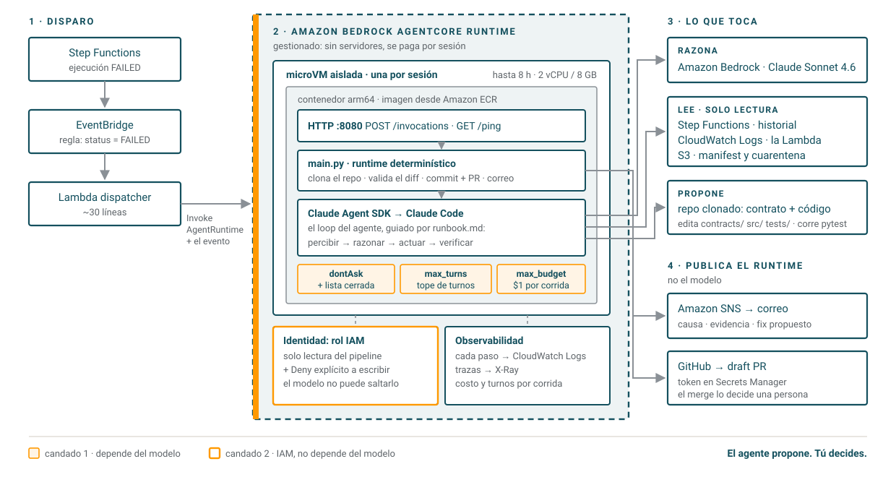

# Guía paso a paso: un agente de monitoreo en Amazon Bedrock AgentCore

Al terminar vas a tener un agente que **despierta solo cuando tu pipeline falla**, diagnostica la
causa leyendo AWS en **solo lectura**, propone el arreglo como **draft PR** en este repo y te manda el
diagnóstico por **correo**. Tú revisas y decides.



**Tiempo:** ~1 hora la primera vez. **Costo medido:** ~$0.20–0.30 por diagnóstico (Claude Sonnet 4.6
en Bedrock); la infraestructura en reposo cuesta centavos al día.

---

## 0. Qué necesitas

| Herramienta | Para qué | Comprobar |
|---|---|---|
| Cuenta de AWS con permisos de administrador | desplegar todo | `aws sts get-caller-identity` |
| **AWS CLI v2 reciente** | comandos de la demo (las versiones viejas no traen `bedrock`) | `aws --version` |
| **Docker** con soporte para `linux/arm64` | construir la imagen del agente | `docker info` |
| **Terraform ≥ 1.10** | la infraestructura | `terraform version` |
| Python 3.10+ y `jq` | tests y scripts | `python3 --version`, `jq --version` |
| Una cuenta de GitHub | el agente abre PRs en tu fork de este repo | — |

**El pipeline.** El agente vigila una máquina de estados de Step Functions que valida datos contra un
contrato. Esta demo asume un pipeline llamado `evtpipe-dev` con los buckets `evtpipe-dev-bronze`,
`evtpipe-dev-meta` y `evtpipe-dev-quarantine` y la Lambda `evtpipe-dev-pipeline`. Si tu pipeline se
llama distinto, cambia `pipeline_project` y `pipeline_env` en `infra/variables.tf`: el agente
encuentra todo por esos nombres.

---

## 1. Clona y prueba en local (5 min)

```bash
git clone https://github.com/<tu-usuario>/de-pipelines-a-agentes.git
cd de-pipelines-a-agentes
python -m pip install pytest
python -m pytest -q                                                            # 3 passed
PYTHONPATH=src python -m eventos.validacion data/crm_events_schema_break.jsonl  # FALLA: quarantine rate 100.00% ...
```

Ese último comando es, en pequeño, la falla de la demo: el CRM renombró `customer_id` a
`customerId` y el 100% del lote no cumple el contrato.

---

## 2. Habilita el modelo en Bedrock (10 min, hazlo primero)

Es lo que más puede tardar y lo que más sorprende.

```bash
aws sso login --profile <tu-perfil>
export AWS_PROFILE=<tu-perfil> AWS_REGION=us-east-1
make check-bedrock     # debe listar us.anthropic.claude-sonnet-4-6 como ACTIVE
```

Haz una llamada de prueba con un usuario administrador. Así Bedrock crea la suscripción al modelo:

```bash
aws bedrock-runtime converse --model-id us.anthropic.claude-sonnet-4-6 \
  --messages '[{"role":"user","content":[{"text":"di ok"}]}]'
```

> **Si ves `403 ... INVALID_PAYMENT_INSTRUMENT`**: los modelos de Anthropic en Bedrock se habilitan
> mediante **AWS Marketplace**, y Marketplace exige una **tarjeta válida como método de pago por
> defecto**, aunque tengas créditos (los créditos promocionales normalmente no cubren Marketplace).
> Agrégala en *Billing → Payment preferences*, espera ~5 minutos y repite la llamada.

---

## 3. Construye el agente y pruébalo en seco (10 min)

```bash
make build                    # imagen arm64 (AgentCore la exige)
make dry-run                  # carga runbook, opciones y binarios; sin modelo ni AWS
make smoke-agentcore-local    # levanta el contrato HTTP de AgentCore: /ping y /invocations
```

Mientras tanto, lee las tres piezas del agente:

- **`agent/runbook.md`**: sus instrucciones. Qué leer, en qué orden y qué no hacer nunca.
- **`agent/main.py`**: el *runtime*. Lo que importa:
  - `AWS_READ_TOOLS`: la **lista cerrada** de comandos que puede usar.
  - `permission_mode="dontAsk"`: todo lo que no esté en la lista **se deniega sin preguntar**.
  - `max_turns` y `max_budget_usd`: los topes.
  - `open_pull_request()`: el commit, el push y el PR los hace **código**, no el modelo. Antes
    verifica que el diff solo toque `contracts/`, `src/` y `tests/`.
- **`agent/Dockerfile`**: Python + AWS CLI + git + el SDK (que trae el binario de Claude Code).

---

## 4. Despliega la infraestructura (15 min)

```bash
echo 'notification_email = "tu-correo@ejemplo.com"' > infra/terraform.tfvars
make validate     # fmt + validate, sin tocar AWS
make infra-ecr    # primero solo el repositorio ECR...
make push         # ...luego la imagen (el runtime no se puede crear sin ella)
make apply        # EventBridge, dispatcher, AgentCore Runtime, IAM, SNS y secretos
```

`make apply` crea:

| Recurso | Qué hace |
|---|---|
| Regla de **EventBridge** | escucha `Step Functions Execution Status Change` con `status = FAILED` de tu pipeline. Es inmediata, no una alarma por hora. |
| **Lambda dispatcher** | llama `InvokeAgentRuntime` con el evento. Una sola vez: sin reintentos. |
| **AgentCore Runtime** | corre el contenedor en una microVM aislada por sesión. |
| **Rol IAM** del agente | solo lectura de Step Functions, Logs y S3 del pipeline, más un `Deny` explícito a escribir. |
| **SNS** + suscripción | el correo con el diagnóstico. **Confirma el correo de suscripción que te llega.** |
| **Secrets Manager** | `demo-agent/github-token` (vacío; lo llenas en el paso 5). |

> **Si el agente falla con `403 ... aws-marketplace:ViewSubscriptions`**: el rol que invoca el modelo
> también necesita permisos de Marketplace. Ya vienen en `infra/iam.tf` (`BedrockModelSubscription`).

---

## 5. Dale permiso para abrir PRs (5 min)

1. En GitHub: *Settings → Developer settings → Fine-grained tokens → Generate new token*.
2. **Repository access:** solo tu fork de este repo.
3. **Permissions:** *Contents: Read and write* y *Pull requests: Read and write*. Nada más.
4. Guárdalo en el secreto. Lo lee el runtime; el modelo nunca lo ve:

```bash
read -s GHT && aws secretsmanager put-secret-value --secret-id demo-agent/github-token --secret-string "$GHT"; unset GHT
```

Si tu fork tiene otro nombre, ajusta `github_repo` en `infra/terraform.tfvars` y corre `make apply`.

---

## 6. Rompe el pipeline y mira al agente (5 min)

En una terminal:

```bash
make break    # genera 102 eventos válidos, renombra customer_id → customerId y los sube a bronze
make run      # corre el pipeline: FAILED en ~10 s (100% MISSING_REQUIRED)
```

En otra:

```bash
make watch    # los pasos del agente en vivo
```

Vas a ver al agente:

1. Leer el historial de Step Functions y encontrar el `DataQualityError`.
2. Buscar el `run_id` en los logs de la Lambda.
3. Leer el `manifest.json` en S3: `MISSING_REQUIRED: 102` y `unexpected_fields: ["customerId"]`.
4. Editar el contrato y el código, agregar tests y correr `pytest`.
5. Si intenta algo fuera de su lista, verás **DENEGADO**: es el guardrail funcionando.

**Lo que medimos:** del FAILED al correo, **~70–90 segundos**; 7–14 turnos; **$0.19–0.28**.

Después:

- **Correo**: causa, evidencia, fix propuesto y link al PR.
- **GitHub**: un **draft PR** con contrato, código y tests; el CI corre `pytest`.
- **Tú**: revisas (con Claude Code, si quieres) y decides el merge. El agente propone; tú decides.

---

## 7. Si algo no funciona

| Síntoma | Dónde mirar | Causa habitual |
|---|---|---|
| No llega el correo | `./demo/watch_agent.sh dispatcher` | suscripción de SNS sin confirmar |
| `403 ... INVALID_PAYMENT_INSTRUMENT` | logs del agente | sin tarjeta válida para Marketplace (paso 2) |
| `403 ... aws-marketplace:*` | logs del agente | falta `BedrockModelSubscription` en el rol (paso 4) |
| El agente corre varias veces por una falla | logs del dispatcher | reintentos del cliente; el dispatcher usa `read_timeout` largo y 1 intento |
| PR "bloqueado" en el correo | `agent_result` en los logs | el agente tocó rutas fuera de `contracts/`, `src/` y `tests/`; el runtime no commitea |
| Todas las corridas fallan, incluso con datos buenos | `make reset` | el pipeline solo marca como procesados los lotes que **pasan**; un archivo roto se relee siempre |

**Plan B sin AgentCore:** `make runtime-fargate` corre el mismo agente en ECS Fargate (mismo contenedor);
`./demo/run_local.sh` lo corre en tu máquina contra AWS real.

---

## 8. Limpieza

```bash
make destroy    # borra la infraestructura del agente; no toca el pipeline
```

Borra también el token de GitHub si ya no lo necesitas.
